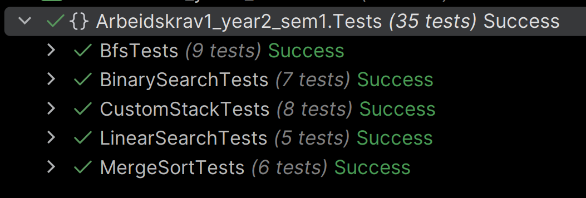

# Test suite for Arbeidskrav1
Semester: 1
Year: 2

---

## About
This test suite covers the test cases for tasks 1-5 in the `Arbeidskrav`.  
Each collection of tests is named accordingly, and the tests within are named using the convention:   
`Method -> Expectation -> Condition`,  
so a test could be named like this:  
`Bfs_ReturnsCorrectOrder_FromStartNode` and  
`CustomStack_CatchesInvalidOperationException_OnPeek_WhenStackIsEmpty`.

---

## Tech Stack

| Component  | Name            |
|------------|-----------------|
| Framework  | .NET 10         |
| Language   | C#              |
| Test Suite | xUnit           |
| IDE        | JetBrains Rider |

---

## Build and run

```bash
dotnet build
```

```bash
dotnet test
```

---

## Test Suite Contents
Arbeidskrav1_year2_sem1.Tests  
Total amount: 35



**[BfsTests](BfsTests.cs)**  
9 tests

**[BinarySearchTests](BinarySearchTests.cs)**  
7 tests

**[CustomStackTests](CustomStackTests.cs)**  
8 tests

**[LinearSearchTests](LinearSearchTests.cs)**  
5 tests

**[MergeSortTests](MergeSortTests.cs)**  
6 tests

---

## Sources
- xUnit Shared Context (Constructor and Dispose):  
https://xunit.net/docs/shared-context