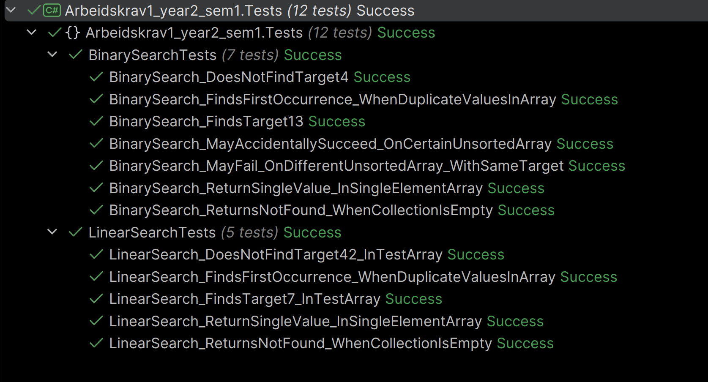

# Task 1 - Linear and Binary Search


## Overview
- [Implementation](#implementation)
  - [LinearSearch](#linearsearch)
  - [BinarySearch](#binarysearch)
- [Test Results](#test-results)
- [Analysis](#analysis)
- [Sources](#sources)

---

## Implementation
### LinearSearch():

The class that contains `LinearSearch()`:  
[Search.LinearSearch()](Task1_LinearSearchAndBinarySearch/Models/Search.cs)

**Naming Choice**  
The name `Search` was chosen for the file, as opposed to `LinearSearch`, to avoid ambiguous naming.  
The method name is `LinearSearch()`, so the call would be `Search.LinearSearch(array, target);`  
I later decided to group both `LinearSearch()` and `BinarySearch()` in the same class due to being similar
in nature (regardless of differences in how they operate). This follows how many of the built-in methods are set up
as well (similar use case, same class).

**Loop Decision**  
I decided to use a `for loop` in my Linear Search, because the for loop hands me the index "for free", omitting
the need to initialize a variable for storing the index.

**Comparison Counter**  
I added a `linearSearchComparisons` counter that gives me the exact number of comparisons processed before
finding the target (if found).

**What Is It Counting**  
It counts _every_ occurrence of comparison done to each element.

**Encapsulation**  
I opted to go for internal and private in the class.  
The class itself is internal, with a private backing field for the `_comparisons` counter,
and an internal property getter `Comparisons => _comparisons` for displaying the data.  
I initially opted for a method accessor in order to display the data, but decided this was the cleaner
approach.

**Resetting the Comparison Counter**  
Initially I had a method accessor for resetting the counter. After some thinking, I decided that this was an
unnecessary risk - forgetting to manually reset the counter would produce the wrong result, and nothing outside the class should bear that responsibility; not the developer, not Program.cs.  
I instead wrote `LinearSearch()` to call `ResetComparisons()` at the very start of the method, ensuring the counter
always starts with a state of 0. The method `ResetComparisons()` was then set to its appropriate access modifier: `private`.

---

### BinarySearch():
The class that contains method `BinarySearch()`:  
[Search.BinarySearch()](Task1_LinearSearchAndBinarySearch/Models/Search.cs)

**Naming Choice**  
Refer to the same paragraph of `LinearSearch()`.

**Loop Decision**  
As is standard for loops where you do not know exactly how many iterations you will need, I decided
to use the while loop for this algorithm. It runs on the condition set being true, and keeps going until the
condition is no longer true (`while (left <= right)` => keep iterating).

**Comparison Counter**  
`BinarySearch()` has its own `binarySearchComparisons` counter to keep track of the number of comparisons made.

**What Is It Counting**  
While `LinearSearch()` only asks once per element, `BinarySearch()` has three different code branches, but only two of 
them perform comparisons.  
`is mid == target?` is counted during every iteration, and the directional  
`is mid < target?` is counted if the first
check is false.  
Directional `is mid > target` runs only if the two first are false and does not perform a comparison.
This is because an `else if` chain was used to control the flow of the algorithm.

**Encapsulation**  
As with `LinearSearch()`, the same encapsulation convention is used for `BinarySearch()`. The method is `internal`
and the backing field for the counter is `private` with an internal getter for displaying value, and a `private`
helper for resetting the counter from within the class (called from the start of `BinarySearch()`).

**Guarantee The Leftmost Occurrence**  
In a test array `int[] binarySearchArray = [2, 5, 5, 7, 9, 9, 11, 13, 17, 20, 24, 27, 31, 36, 38];`  
when the target is `9`, hand trace to prove guarantee:

```text
left = 0, right = 14 (array.Length - 1)

Iteration 1:
mid = 0 + (14-0) / 2 = 7 -> array[7] = 13
    Comparison: 13 == 9 ? No. (Counter: 1)
    Comparison: 13 < 9? No. -> else: right = mid - 1 = 6 (Counter: 2)

Iteration 2:
left = 0, right = 6
mid = 0 + (6-0) / 2 = 3 -> array[3] = 7
    Comparison: 7 == 9? No. (Counter: 3)
    Comparison: 7 < 9? Yes. -> left = mid + 1 = 4 (Counter: 4)

Iteration 3:
left = 4, right = 6
mid = 4 + (6-4) / 2 = 5 -> array[5] = 9
    Comparison: 9 == 9? Yes -> store -> right = mid - 1 = 4 (Counter: 5)

Iteration 4:
left = 4, right = 4
mid = 4 + (4-4) / 2 = 4 -> array[4] = 9
    Comparison: 9 == 9? Yes -> store -> right = mid - 1 = 3 (Counter: 6)

left = 4, right = 3 -> left <= right = false -> loop ends

return lowestMatchResult.
```

The algorithm first finds a hit at index 5, which is not the leftmost (lowest) target value 9.  
It then stores that "hit", keeps looking to the left, and finds the actual leftmost target value
9 at index 4.  
It returns the value of the variable that holds the target: `lowestMatchResult`, or the sentinel `-1` if not found.


---

## Test Results
The tests were written to cover the specified edge cases and searches.  
The tests also assert number of comparisons using the respective counters per algorithm 
are consistent with the actual number of counts.

**LinearSearch():**  
- `LinearSearch_DoesNotFindTarget42()`
- `LinearSearch_FindsFirstOccurrence_WhenDuplicateValuesInArray()`
- `LinearSearch_FindsTarget7_InTestArray()`
- `LinearSearch_ReturnSingleValue_InSingleElementArray()`
- `LinearSearch_ReturnsNotFound_WhenCollectionIsEmpty()`

**BinarySearch():**  
- `BinarySearch_DoesNotFindTarget4()`
- `BinarySearch_FindsFirstOccurrence_WhenDuplicateValuesInArray()`
- `BinarySearch_FindsTarget13()`
- `BinarySearch_ReturnSingleValue_InSingleElementArray()`
- `BinarySearch_ReturnsNotFound_WhenCollectionIsEmpty()`

In addition, I also wrote two more tests for `BinarySearch()` proving how a search on an
unsorted array _might_ coincidentally succeed, and how it most likely will now:
- `BinarySearch_MayAccidentallySucceed_OnCertainUnsortedArray()`
- `BinarySearch_MayFail_OnDifferentUnsortedArray_WithSameTarget()`



---

## Analysis
**Big-O explanation for both algorithms**

| Algorithm        | Time Complexity (best case) | Time Complexity (worst case) |
|------------------|-----------------------------|------------------------------|
| `LinearSearch()` | `O(1)`                      | `O(n)`                       |
| `BinarySearch()` | `O(log n)`                  | `O(log n)`                   |

**LinearSearch Best-Case O(1) - Constant Time**  
- Target is located at the first position of the array (index 0).
- The `for loop` checks index 0 first, and if it's the target, it returns immediately.

**LinearSearch Worst-Case O(n) - Linear Time**  
- The target is at the very end of the array, or does not exist in the array at all.
- The algorithm systematically scans through the entire array, one element of (n) elements at a time, 
  until the whole array has been scanned, and it can return either the index if the target exists, or `-1` if not.

**BinarySearch Best-Case O(1) - Constant Time**  
- The target is located at the exact middle index, and the algorithm finds it at the very first step.
- The algorithm calculates the middle index (`mid`), compares it to the target, and finds an immediate match to return.

**BinarySearch Worst-Case O(log n) - Logarithmic Time**  
- The target is at one of the extreme boundaries of the final division, requiring the search area to be halved down 
  to just 1 element, or does not exist in the array at all.
- Because the algorithm halves the remaining search area at every single step, the number of comparisons required to 
  exhaust the list of size (n) scales logarithmically.

<br>

**Why Does BinarySearch Require a Sorted Array?**  
Imagine that you are sifting through a physical catalogue of phone numbers. You are likely looking for a specific 
person, and because of that, you don't start at the first page and look at every element until you reach the one you are 
looking for. Instead, you open the catalogue to the middle part, and see where that lands you. If the letters are "smaller" 
than the letter you are looking for, you know that your target is to the right. If the letters are greater than the 
one you are looking for, you know that your target is to the left. So you do the same as before; you open that half and part
it down the middle. The process repeats until you find your target, or realize the target doesn't exist in the catalogue at all.    

The same principle counts for Binary Search; if the array isn't sorted, the algorithm has no way of knowing which 
half to continue its search in. The algorithm's decision rule of `is mid < target -> go right; is mid > target -> go left;` 
is only a guarantee when everything to one side is actually smaller and everything on the other side is greater. 
In an unsorted array, this is simply not a guarantee.  
It _could_ succeed if the target happened to exist at the very middle index of the array, but the 
result would be very unstable. It wouldn't succeed at all if the target didn't perfectly line up with randomized numbers 
that happened to mathematically work. It would be a game of chance, if anything.

**Costs of Sorting Prior to Searching**  
I picture it in real-world terms. Let's say I have a task that I have to repeat often, like emptying the dishwasher.  
I have two choices ahead of the unloading; I can toss things randomly in there before running the wash cycle, or I can 
decide to order the items (elements) in a sensible fashion so that the unloading is quicker and more efficient.  
The ordering will take me a few minutes longer than if I just randomly threw things into random positions in the dishwasher.
If I knew that I only needed to empty the dishwasher one time, ever, I probably wouldn't mind the extra time spent unloading.  
However, if I knew I was going to have to do this many times, I'd prefer sorting the items properly ahead of time.  
(This analogy falls slightly apart since you have to repeat the sorting-action every time you load the dishwasher, but let's
imagine that once the items have their position, they magically fall into place without extra effort ahead of every wash cycle.)  

The same goes for Binary Search, and the cost of the sorting ahead of searching. The cost is up-front and done once, 
and in return you get as many quick searches as you want.  
However, Binary Search isn't always the winner, and one has to consider the total cost.  

Visualized with an example: 
```text
Collection of n = 1000 elements
k number of searches

Scenario 1: k = 2 searches

Strategy A (Linear): k = 2 (searches)
    2 x 1000 = 2000 operations

Strategy B (Sort + Binary):
    Sorting cost: 1000 log2(1000) = roughly 10 000 operations
    Searching cost: 2 x log2(1000) = roughly 20 operations
    Total: 10 000 + 20 = 10 020 operations

Winner: Linear, about 5x faster, the sorting cost was wasted
==================================
Scenario 2: k = 100 searches

Strategy A (Linear): k = 100 searches
    100 x 1000 = 100 000 operations

Strategy B (Sort and Binary): 
    Sorting cost: roughly 10 000 operations
    Searching cost: 100 x 10 = roughly 1000 operations
    Total: 10 000 + 1000 = 11 000 operations

Winner: Binary, 9x faster, the sorting cost paid for itself.

```

In conclusion, a task that is repeated many times over is usually something you want to effectuate. A one-time task matters 
less because it's not going to be something that consumes your time frequently. But one must also look at the cost of the
operations. As seen in the example above, where Scenario 1 causes Binary Search to be much slower than Linear Search, because 
Binary Search also has a sorting cost upfront + the searching cost itself. Scenario 2 shows how Binary Search emerges 
victorious when the calculations are done, and the upfront cost of sorting has paid for itself in full.

From the example above, one could assume the break-even point where a Binary Search and the sorting cost would 
be the more efficient algorithm is well below 100 searches.  
I attempted to calculate this with help from AI, but was unable to follow the steps and therefore omitted using it 
here.


**My definition of what counts as one comparison**  
For `BinarySearch()`:
  - Whenever a comparison is made:  
    "`is mid == target?`" every iteration.  
    If this is `false`, then   
    "`is mid < target?`".   

For `LinearSearch()`:
  - For every iteration of every element. 


**My reflection on the unsorted-binary-experiment**  
I decided to include xUnit tests for this experiment. Both using the same target, and two different arrays where 
one is "lucky" and the other one is "unlucky". I deemed this a suitable excuse to write a couple of more tests, because 
they more than anything proves how it _might_ succeed, but likely _won't_.

First, a look at the "lucky array" test:
```csharp
[Fact]
    public void BinarySearch_MayAccidentallySucceed_OnCertainUnsortedArray()
    {
        // Arrange
        int[] luckyArray = { 3, 25, 7, 19, 12 };

        // Act
        var result = Search.BinarySearch(luckyArray, 7);

        // Assert
        Assert.Equal(2, result);
    }
```
As we know, the `BinarySearch()` divides and conquers; it splits the array in two by calculating the `mid`.  
When it does so in this specific, unsorted array, the `mid` lands on `7`.  
So we choose `7` as our `target`.  
By coincidence, BinarySearch finds the target on the first step, because `mid == target`, and is able 
to return immediately. When we assert that the target will be found at index 2 in the `luckyArray`, we get lucky.

The next test uses a different array, but the same target.
```csharp
[Fact]
    public void BinarySearch_MayFail_OnDifferentUnsortedArray_WithSameTarget()
    {
        // Arrange
        int[] unluckyArray = { 25, 3, 19, 7, 12 };

        // Act
        var result = Search.BinarySearch(unluckyArray, 7);

        // Assert
        Assert.Equal(-1, result);
    }
```
In this test, we also choose `7` as our target in an unsorted, but unlucky, array.  
The `mid` index 2 now has the value `19`. `is 19 == 7?` No, it is not. So the algorithm then asks 
`is 19 < 7?` No, it is not, so it assumes the target must be on the left.  
Looking at the array, we can clearly see the target is not on the left side at all, but because `BinarySearch` lives 
by its `Divide And Conquer` rule, it won't be checking the full array, only the left half, because `mid > target`.

Unlike the first test, this one will result in `-1`, because the algorithm will discard the half where the target lives, 
due to the rules and conditions it follows (`is 19<7? No -> right = mid -1`).

Imagining this in production we quickly understand why the array **must** be sorted for `BinarySearch` to 
be trustworthy. A good system cannot depend on a coin flip chance of success, and there has to be guardrails 
ensuring we can trust the algorithm. To be able to trust the algorithm, it needs us to fulfill its demands. 

---

## Sources
- [@IAmTimCorey - YouTube - Initial Setup and Best Practices - Spectre Console Series](https://www.youtube.com/watch?v=-ZRnq8ke_bU)