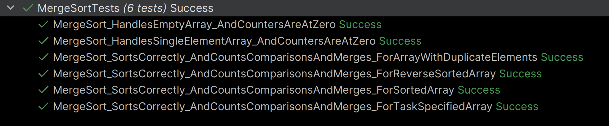
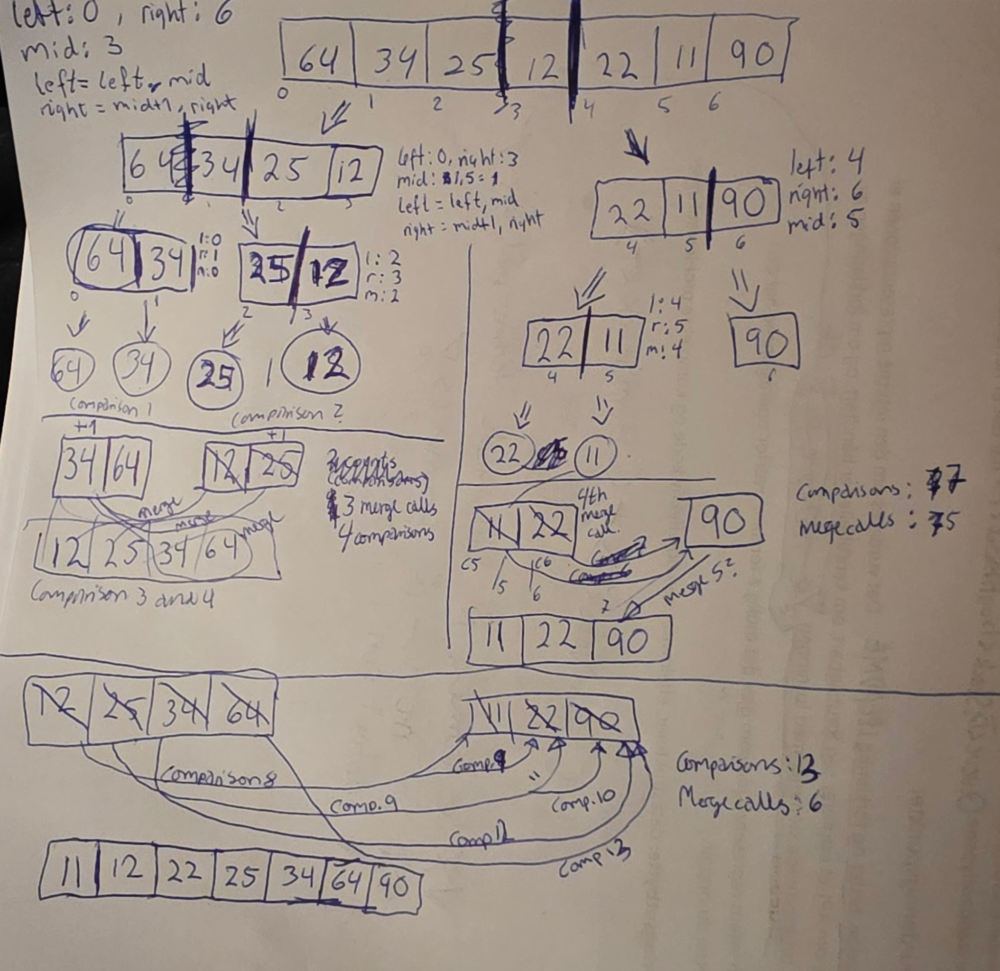
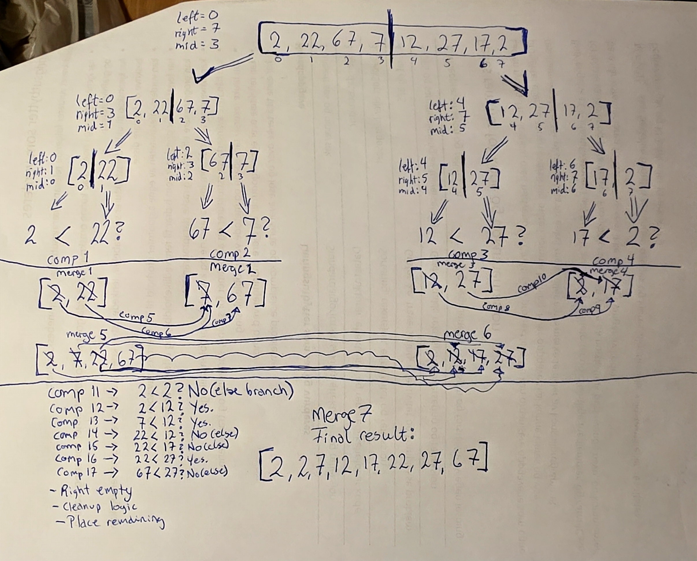
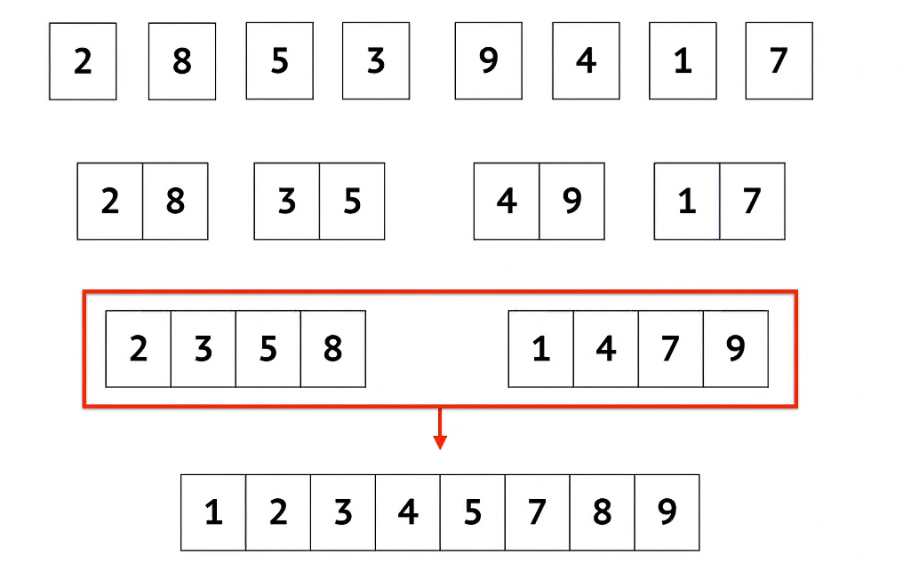
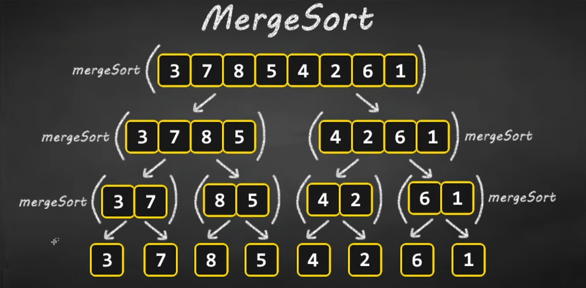
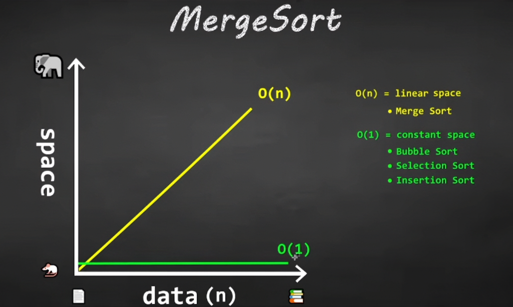

# Task 3 - Divide And Conquer

---

## Overview
- [Implementation](#implementation)
- [Tests](#tests)
- [Operation Count](#operation-count)
- [Analysis](#analysis)
- [Bug Fixing](#bug-fixing-)
- [Reflection](#reflection)
- [Sources](#sources)

---

## Implementation
While I like both `QuickSort` and `MergeSort`, I eventually landed on `MergeSort` for this task, simply because I 
think it is such an interesting and thorough algorithm, and because it guarantees `O(n log n)` time complexity every time - 
`best / avg / worst`. It also carries some fundamental similarities to `BinarySearch` in the way it processes arrays, 
which I also find fascinating.  

**void ResetAndRunMergeSort(int[] array)]**:  
```csharp
internal static void ResetAndRunMergeSort(int[] array)
    {
        ResetComparisonCounter();
        ResetMergeCallCounter();
        
        MergeSort(array, 0, array.Length - 1);
    }
```
A very plain orchestrator to ensure the correct order of steps:  
- Reset first, only once per counter
- Run the `MergeSort()` algorithm
- Ensure correct counter data between runs


**void MergeSort(int[] array, int left, int right)**:  
```csharp
private static void MergeSort(int[] array, int left, int right)
    {
        if (left >= right) // base case
        {
            return;
        }
        int mid = left + (right - left) / 2;
        MergeSort(array, left, mid);
        MergeSort(array, mid + 1, right);
        _mergeCallCounter++;
        Merge(array, left, mid, right);
    }
```
Base case for `MergeSort()`:  
`if (left >= right) -> stop`  
The condition avoids infinite recursion because it guarantees a stop as soon as `left>=right`.  
Each recursive call operates on a smaller range between left and right until the base case is reached.

Sectioning rule:  
`mid belongs to left`.  
Mid has to be included in the array so it's not skipped over, because that causes instability bugs and generates 
invalid results. Both Merge and MergeSort abide by this rule.


**void Merge(int[] array, int left, int middle, int right)**:  
```csharp
private static void Merge(int[] array, int left, int middle, int right)
    {
        int[] leftArray = array[left..(middle +1)];
        int[] rightArray = array[(middle +1)..(right + 1)];

        int l = 0, r = 0, o = left;

        while (l < leftArray.Length && r < rightArray.Length)
        {
            _comparisonCounter++;
            if (leftArray[l] < rightArray[r])
            {
                array[o] = leftArray[l++];
                o++;
            }
            else
            {
                array[o] = rightArray[r++];
                o++;
            }
        }
        while (l < leftArray.Length)
        {
            array[o] = leftArray[l++];
            o++;
        }

        while (r < rightArray.Length)
        {
            array[o] = rightArray[r++];
            o++;
        }
    }
```
The temporary arrays `leftArray` and `rightArray` are sized like this to abide by the rule set in `MergeSort` that says
`mid belongs to left`. In order to achieve this, the original array was sliced to place `left` and `mid+1` into `left`, 
and `mid+1` to `right +1` in `right`. The slices need the `+1` due to the end-exclusive behavior in C#'s slicing syntax. 
It includes the start range, and excludes the end range. `+1` ensures we get the ends, and the `mid+1` for `right`'s start 
ensures `mid` stays with `left`, and `right`'s start begins one step to the right of `mid`.


Helper methods: `void ResetComparisonCounter()` and `void ResetMergeCallCounter()` are very simple and do just that, nothing more.


**Choices**  
`MergeSort()` set to `private`.  
While adding the counters to the `Sort` class, I ended up writing a wrapper method that would safely 
handle the resetting of the counters to avoid corrupted results that resetting inside the `MergeSort()` method would lead to. 
To do this safely, I added those resets to the top of the wrapper method (`ResetAndRunMergeSort(int[] array)`).  
The counters are now reset only once, and _then_ the `MergeSort()` is performed, ensuring valid counter results.   
Due to this I decided that `MergeSort()` should be `private` as there was no longer any need for it to be called 
directly from outside the class `Sort` itself. No needless exposure.  

The test suite will also use the wrapper method to ensure non-corrupted counters, while still achieving 
the correct behavior from the `MergeSort()` method. 

`Merge()`, `ResetComparisonCounter()`, and `ResetMergeCallCounter` are also set to `private` because they are only run 
from within the class itself and do not need to be exposed outside of it.  

I opted to write the various test cases available to be run from the project as well as the unit tests.  
For this I decided to implement a basic menu that utilizes reused code from previous projects and helper methods for 
flow control. I also extracted the text outputs into `RunDemo()` method inside `Demo` class so that I would not have 
to repeat 6 blocks of almost identical text. It uses parameters in place of the labels and arrays.  


---

## Tests
**Tests Run Successfully**  


**Added bonuses**:  
Hand-traces to ensure the correct results before asserting the counter values in the tests.  
Full hand-trace on array `[64, 34, 25, 12, 22, 11, 90]`:
  
Excuse the chaos and typos, but I spent too much time doing this for it just to remain unseen by anyone else than me.

Full hand-trace on the array with duplicate values: `[2, 22, 67, 7, 12, 27, 17, 2]`:  
  
_(As I forgot to clearly write it down, here is the counter tally:  
Total comparisons: 17  
Total merge calls: 7.)_

**Test Names**  
  - `MergeSort_HandlesEmptyArray_AndCountersAreAtZero`
  - `MergeSort_HandlesSingleElementArray_AndCountersAreAtZero`
  - `MergeSort_SortsCorrectly_AndCountsComparisonsAndMerges_ForArrayWithDuplicateElements`
  - `MergeSort_SortsCorrectly_AndCountsComparisonsAndMerges_ForReverseSortedArray`
  - `MergeSort_SortsCorrectly_AndCountsComparisonsAndMerges_ForSortedArray`
  - `MergeSort_SortsCorrectly_AndCountsComparisonsAndMerges_ForTaskSpecifiedArray`

**Test Cases**  
- Task specified array: `[64, 34, 25, 12, 22, 11, 90]`
- Sorted array from task: `[1, 2, 3, 4, 5]`
- Reversed sorted array from task: `[9, 8, 7, 6, 5]`
- An array with duplicate values: `[2, 22, 67, 7, 12, 27, 17, 2]`
- An empty array: `[]`
- A single-element array: `[1024]`

**Why This is Tested**  
To ensure correct counter data and correct sorting behavior.

---

## Operation Count
**What is Counted**  
`Comparisons` and `Merge()` calls.  

I refer to the manually hand-traced images that you can see in the [Tests section](#tests).

---

## Analysis
`MergeSort()` uses temporary storage, and then the `Merge()` method in order to successfully merge 
the values from those temporary arrays back into the original array in the correct order.  
The logic guarantees a correct output because of how the sections are sliced and defined.  
At the point when either `left` or `right` side is empty, the remaining values are already sorted by definition 
and can be placed into the array without comparison, because the process leading up to that has made sure of the 
order. The entire array is included, which ensures that all values are taken into consideration.  
The sizing is not hardcoded and will work with any size array, both for `MergeSort()` itself and its helper 
`Merge()`.  
Each side is split down the middle until only single elements remain. Then the comparison and merge starts, 
always placing the smallest element at the first index of the temporary array, working its way up, for both sides
(left first, then right).  
This process ensures the correct order when the algorithm has run its course, which can be seen 
in the `Demo` that runs from `Program.cs`.  
The test suite also covers all task specified cases, and produces the same results as the demo. 

**Temporary Storage:**  
`leftArray` - `int[] leftArray = array[left..(middle +1)];`  
`rightArray`- `int[] rightArray = array[(middle +1)..(right + 1)];`

**Time and Space Complexity:**  
`MergeSort()` has a guaranteed time complexity of `O(n log n)` for `best/worst/average`.  
The time complexity does not vary based on the input, like `BinarySearch()` did, because it always splits 
down the mid-point regardless of which values are there.   
The space complexity degrades to `O(n)` due to the use of temporary storage (`leftArray` and `rightArray`), 
which is allocated during each `Merge()` call because `MergeSort()` does not `sort-in-place`.

**Duplicate-Value Stability**  
I made an observation during my hand-trace of the array with duplicated values.  
In that specific array, the right-side duplicate won "first place" (smallest value in the array), which appears 
incidental rather than guaranteed. A different array with different duplicates may not end up placing the right-side 
value before the left-side value, as it depends on the value itself and the order of the array.

**Strengths And Weaknesses**  
`Strengths:`  
- Stable
- Fast (guaranteed `O(n log n)` time complexity)
- thorough

`Weaknesses:`
- More expensive in space complexity

---

## Bug Fixing  
**`MergeSort()`:**
start and end boundaries were off, neither recursive call included `mid`.     
I had set the left call's range to `left` through `mid -1`, and the right call's range from `mid+1` through `right`, 
skipping `mid` entirely on both sides.  
The rule I intended to operate by was `mid belongs to left`, so the left call needed to end at `mid` itself.  
I had also been mixing up "indice slicing" and `start/stop` ranges.
This led to bugs itself, and also trailed into the `Merge()` method.
With the right questions from `Claude.ai` (documented in [AIUse.md](../Docs/AIUse.md)), 
I was able to step my way through what I had done wrong and correct it.  
However, the next couple of bugs still remained:

**`Merge():`**  
the array slices were off by one, for the same underlying reason: `middle` was not included where it needed to be.    
I had again mixed up two different systems: `MergeSort()`'s parameters that are plain numbers, and `Merge()`'s array slices that 
use C#'s `exclusive-end range` syntax, requiring the `+1` adjustment to include the boundary.  
I made the wrong slices for both `leftArray` and `rightArray` several times before getting it right, 
and due to the previous bug, even when the arrays were correctly sliced, it produced bugs.  
`leftArray` did not include `middle` for quite some time, and the confusion from the bug above also 
translated into this, where I got "slicing range" and "start and end range" mixed up.  
`Claude.ai` walked me through this by asking the right questions and making me think my way to the answer, 
and I realized one couldn't have worked without the other (MergeSort and Merge) due to both of them containing 
bugs that would break the other even if one had the correct logic. They followed different rules (`mid belongs to left`),
and didn't speak the same language.  
By walking through my own set rule, ensuring the `start` and `end` ranges in `MergeSort` were correct, 
and tracing through my indices setup, I was able to gather the error:  
the left ended at the wrong boundary,   
and the right ended at the wrong boundary. 

Fixes were applied to both methods and tested on several different arrays to ensure everything was in order.

---

## Reflection
**What went well?**  
- Learning about how to set up the counters, and the algorithm itself
- Seeing the use of a wrapper method to orchestrate the resetting of counters and running the algorithm
- Learning about the sizing of left and right side
- Learning about the slicing of the left and right array
- Implementing the basic menu for this project

**What could've gone better?**  
- I should have started writing the reflection section way earlier

**What did I learn?**  
- Writing the algorithm itself
- Defining left and right side of the array
- Defining left and right sub-arrays and sizing them correctly
- Following a set rule `mid belongs to left` and enforce it
- Moving the pointers of left, right, and original array
- Counting the Merge calls and Comparisons effectively
- Using the base case `if (left >= right) -> stop!` for `MergeSort()`

---

### Sources
- [@Michael Sambol - YouTube - Merge sort in 3 minutes](https://www.youtube.com/watch?v=4VqmGXwpLqc)  
Screenshot from video - step by step splitting, then merge/sort:    
- [@Bro Code - YouTube - Learn Merge Sort in 13 minutes](https://www.youtube.com/watch?v=3j0SWDX4AtU)  
Screenshot from video - step by step splitting, then merge/sort: 
Screenshot from video - Time and Space Complexity: 
- [@Bálint Benedek Tóth - YouTube - Merge Sort Algorithm in C#](https://www.youtube.com/watch?v=8mZhUH3JsR8)  
