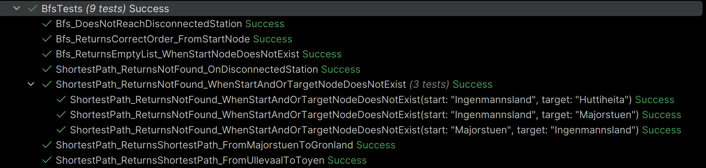

# Task 4 - Graph and BFS


DELETE WHEN FINISHED:  
Model a small, undirected transport network as a graph. Stations are nodes, connections are edges. Use BFS to visit 
all reachable stations from a starting station, and to find the shortest number of stops in the unweighted graph.  

Mark completed with: ✅ 

- ✅ Design a Graph class that stores the network as an adjacency list (example: `Dictionary<string, List<string>>`)
- ✅ Implement `void AddConnection(string stationA, string stationB)` that adds a two-way connection
- ✅ Implement BFS traversal (needs a queue and separate visited tracking)
- ✅ Implement a BFS method that returns the shortest number of edges/stops between two stations. 
- ✅ Clearly define and document the return value when no route exists.
- ✅ Handle a missing start or target station without the program terminating uncontrolled (i.e. without crashing!)
- ✅ Run and document BFS from Majorstuen
- ✅ Tests (BFS from Majorstuen, document visit order, shortest number of stops )
- Document the neighbor-order (when a node has multiple neighbors, the visit order may vary depending on storage order)
- (don't forget to update the [commit history document](../Docs/CommitHistory.md))
- ?? Document the required test graph's edges explicitly (or build your own)
- Explain the complexity `O(V + E)` and why the `FIFO` order means BFS finds the shortest number of stops in an
  unweighted graph.

---

## Overview
- [Implementation](#implementation)
  - [Graph Class](#graph-class)
  - [BFS](#breadthfirstsearch-method)
    - [ShortestPath](#shortestpath)
- [Tests](#tests)
- [Explanation](#explanation)
  - [Distance Count (ShortestPath)](#shortest-path-distance-count)
  - [FIFO](#fifo)
- [Bug Fixing](#bug-fixing)
- [Sources](#sources)

---

## Implementation
### Graph Class
Class setup:

```csharp
namespace Task4_GraphAndBFS.Models;

internal class Graph
{
    private readonly Dictionary<string, List<string>> _adjacencyList = new();
    
    internal void AddConnection(string stationA, string stationB)
    {
        AddNode(stationA);
        AddNode(stationB);
        
        _adjacencyList[stationA].Add(stationB);
        _adjacencyList[stationB].Add(stationA);
    }
    
    internal void AddNode(string node)
    {
        if (!_adjacencyList.ContainsKey(node))
        {
            _adjacencyList[node] = new List<string>();
        }
    }
    
    internal Dictionary<string, List<string>> GetAdjacencyList()  
    {
        Dictionary<string, List<string>> adjacencyListCopy = new();
        foreach (var key in _adjacencyList)
        {
            adjacencyListCopy.Add(key.Key, new List<string>(key.Value));
        }

        return adjacencyListCopy;
    }
}
```
Holds an adjacency list, and the methods `AddConnection()`, `AddNode()`, and `GetAdjacencyList()`.  
`AddNode()` is only called within the class and is therefore set to `private`.  
`AddStation()` calls `AddNode()`, and can be called from elsewhere in the assembly.  
`GetAdjacencyList()` returns a deep copy of the original list, keeping it safe from corruption.

### BreadthFirstSearch Method
BFS method setup:

```csharp
internal static List<string> Bfs(Dictionary<string, List<string>> adjacencyList, string startNode)
    {
        HashSet<string> visited = new();
        Queue<string> queue = new();
        List<string> result = new();
        
        if (!adjacencyList.ContainsKey(startNode))
        {
            return new List<string>();
        }
        
        visited.Add(startNode);
        queue.Enqueue(startNode);

        while (queue.Count > 0)
        {
            var current = queue.Dequeue();
            result.Add(current);

            if (adjacencyList.TryGetValue(current, out var neighbors))
            {
                foreach (var neighbor in neighbors)
                {
                    if (!visited.Contains(neighbor))
                    {
                        visited.Add(neighbor);
                        queue.Enqueue(neighbor);
                    }
                }
            }
        }
        return result;
    }
```
Tracks `visited` nodes using a `HashSet`.  
Uses a `Queue` in order to keep track of who is next up for processing.  
Stores the visitation order in a `List` of strings. 

Base case: `while someone is still waiting in the queue -> go on`.

Discovered nodes are immediately added to `visited`.  
Neighbors are enqueued.  

Guards against `if (!adjacencyList.ContainsKey(startNode)` and exits if the start node doesn't exist in the array. 
Guards against `if (!visited.Contains(neighbor)` and ensures unvisited nodes gets added.  

Returns a list of processed visits in the order they were visited in.

---

### ShortestPath
ShortestPath method setup:

```csharp
internal static int ShortestPath
        (Dictionary<string, List<string>> adjacencyList, string start, string target)
    {
        HashSet<string> visited = new();
        Queue<string> queue = new();
        Dictionary<string, int> distances = new();
        int noResult = -1;

        if (!adjacencyList.ContainsKey(start) || !adjacencyList.ContainsKey(target))
        {
            return noResult;
        }

        visited.Add(start);
        queue.Enqueue(start);
        distances[start] = 0;

        while (queue.Count > 0)
        {
            var current =  queue.Dequeue();
            if (current == target)
            {
                return distances[target];
            }
            
            if (adjacencyList.TryGetValue(current, out var neighbors))
            {
                foreach (var neighbor in neighbors)
                {
                    if (!visited.Contains(neighbor))
                    {
                        visited.Add(neighbor);
                        queue.Enqueue(neighbor);
                        distances[neighbor] = distances[current] + 1;
                    }
                }
            }
        }
        return noResult;
    }
```
Is a modified `Bfs()`, that stops when the condition `current == target` becomes true.  
It doesn't exhaust the array if it finds the target prior.  

Like `Bfs()` is uses a `HashSet` for visited and a `Queue` for the queue.  
It also uses a `Dictionary<string, int> distances` to keep track of the actual steps from start to target.  
Set up with a sentinel value (`-1`) for missing start or missing target, and returns that whenever either is missing.

Guards against `!adjacencyList.ContainsKey(start) || !adjacencyList.ContainsKey(target)`, and exists if either are true.

**ShortestPath Distances**  
The distance counter starts at `distance[start] = 0`, because the start node is 0 steps away from itself.  
The algorithm then checks if the current node `current` is equal to `target`, and returns `distances[target]` if so.  
If the first step is not the target, it loops through the adjacency list (pulling out `neighbors` and loops over `neighbor`)
of neighbors (like `Bfs()`), marking every discovered node as `visited`, `enqueueing` neighbors, and incrementing the
distance like this:  
`distances[neighbor] = distances[current] +1`. So, the distance for `neighbor` is whatever distance is for `current` +1 step.

As soon as the condition `if (current == target)` becomes true, the loop ends, and the steps from start to target is
returned. If the target is not found, it returns the sentinel, `noResult -> -1`.


---

## Tests
test names, test cases, why tests

Tests run successfully:


**Test names**  
- `Bfs_DoesNotReachDisconnectedStation`
- `Bfs_ReturnsCorrectOrder_FromStartNode`
- `Bfs_ReturnsEmptyList_WhenStartNodeDoesNotExist`
- `ShortestPath_ReturnsNotFound_OnDisconnectedStation`
- `ShortestPath_ReturnsNotFound_WhenStartAndOrTargetNodeDoesNotExist`
- `ShortestPath_ReturnsNotFound_WhenStartAndOrTargetNodeDoesNotExist(start: "Ingenmannsland", target: "Huttiheita")`
- `ShortestPath_ReturnsNotFound_WhenStartAndOrTargetNodeDoesNotExist(start: "Ingenmannsland", target: "Majorstuen")`
- `ShortestPath_ReturnsNotFound_WhenStartAndOrTargetNodeDoesNotExist(start: "Majorstuen", target: "Ingenmannsland")`
- `ShortestPath_ReturnsShortestPath_FromMajorstuenToGronland`
- `ShortestPath_ReturnsShortestPath_FromUllevaalToToyen`

**Test Cases**  
- BFS from "Majorstuen", with documentation of visitation order (also in [Program.cs](Program.cs))
- ShortestPath from "Majorstuen" to "Grønland" (with correct result: `4`)
- Route between "Ullevål Stadion" and "Tøyen"
- Isolated station - test traversal and missing route (`Bfs()` and `ShortestPath()`)

**Why This is Tested**  
To ensure correct algorithm behavior, correct distance count between start and target, 
and as a demonstration on how the algorithm works.

---

## Explanation
### Shortest Path Distance Count
The Bfs-based method `ShortestPath()` has the job of finding the shortest path from A to B and returning the amount of steps 
for that path. In order to achieve that, I needed somewhere to store those steps while avoiding having that counter reset 
between iterations.  
For this, I would need to store something more than a basic `int`, because a single counter can't work due to how the 
algorithm does its search by exploring multiple branches simultaneously, at different depths. This means the question of 
"How many nodes have I visited?" versus "How many stops from start to target?" become two entirely different questions.  
Each node needs its own recorded distance that is tied to the specific node that discovered it, one step further every time. 
The solution was using a `Dictionary<string, int> distances`, which stores the key(node) and its integer value.

### FIFO
`Bfs()` uses a `Queue` to keep track of who is next in line.  
A `Queue` uses `FIFO` when organizing this; First in, first out. It always ensures the one that has been waiting the 
longest is dequeued first, just like it works in the queue at the grocery store or the bank.  
Because we also keep track of `visited` nodes, and mark them immediately upon discovery and then add them to the queue, 
and we know that `Bfs()` works on `Breadth-First` (one level at a time), the start node is always placed first in the queue, 
and the next node is always placed second, and so on.  

If we look at a basic example:   
`["A", "B", "C"]` and `["C", "D"]` and use `A` as our starting node, we enqueue the starting node and mark it as visited:  
```text
visited = ["A"]
queue = ["A"]
```
We then deque the first node, `A`, and look at its neighbor(s). There we find `B`(first) and `C`.
`B` is then immediately marked as visited, and put in the queue. Then we find `C`, which is also marked and queued: 
```text
visited = ["A", "B", "C"]
queue = ["B", "C"]
```
When we then dequeue `B` and look at its neighbors, which is `A` and `C`. `A` already exists in visited and is skipped. 
`C` also already exists in visited and is skipped. So now we have: 
```text
visited = ["A", "B", "C"]
queue = ["C"]
```
Next we dequeue `C` and look at its neighbors. We find `A` and `D`. `A` exists in visisted and is skipped. `D` is marked 
and enqueued. Now we have:  
```text
visited = ["A", "B", "C", "D"]
queue = ["D"]
```
We dequeue `D` and look for neighbors. There are none. The loop condition (`while (queue.Count > 0))` becomes
false, the loop ends, and we are left with:
```text
visited = ["A", "B", "C", "D"]
queue = []
```

This process, although very simplified in the example, does the same work in the same order for any array it is working on.  
If we look at `C`, we can see that it was discovered and marked early on while looking up the neighbors of `A`. Due to 
this, it is never processed later via a longer path through `B`. And this is why the first time a node is discovered, 
it is always the shortest distance away from start. `Bfs()` fully finishes one `distance level` before starting the next.

---

## Bug Fixing
I had initially set up `ShortestPath()` with a redundant .Add line: `visited.Add(current)` right after 
dequeue of `current`.  
I was returning the wrong `distances[]` and initially set it to `distances[start]`, which rendered the output useless as it 
would always be `0`.

In `Bfs()` I had a missing `result.Add(current)` after dequeue of `current`, which gave me the corrupt results when 
running the code.

---

## Sources
Any external sources here