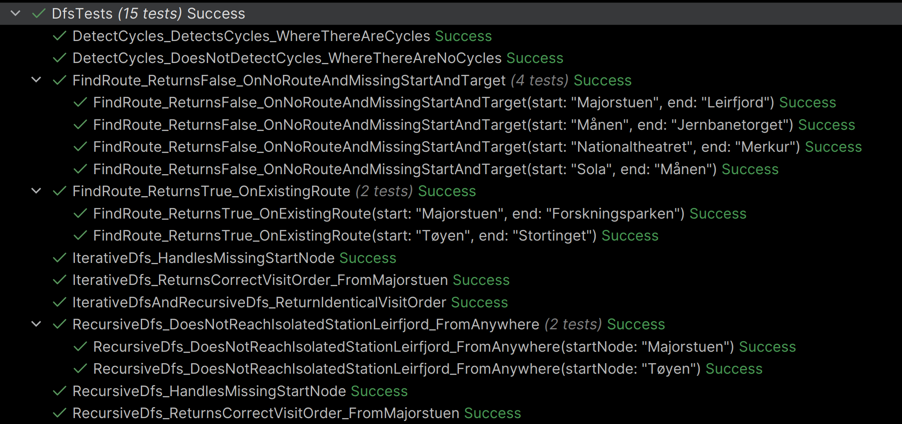
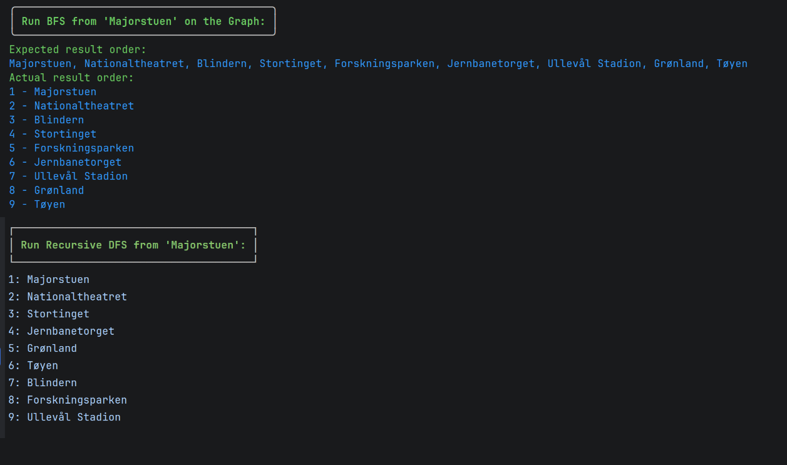

# Task 5 - DFS and Comparison
DFS, and comparison with BFS.

---

## Overview
- [Implementation](#implementation)
  - [Recursive DFS](#recursive-dfs)
    - [Recursive DFS Extension Method](#recursive-dfs-extension-method)
  - [Iterative DFS](#iterative-dfs)
    - [Iterative DFS Extension](#iterative-dfs-extension-method)
- [Tests](#tests)
- [Comparison](#comparison)
- [Explanation](#explanation)
  - [Base Step](#base-step)
  - [Recursive Step](#recursive-step)
  - [O(V + E)](#ov--e)
  - [Differences Between Recursive and Iterative DFS](#differences-between-recursive-and-iterative-dfs)
  - [Risk of StackOverFlowException](#risk-of-stackoverflowexception)
  - [Neighboring Order](#neighbor-order)
- [Reflection](#reflection)

---

## Implementation

### Recursive DFS
**Recursive DFS implementation, orchestrator:**
```csharp
internal static List<string> RecursiveDfs
        (Dictionary<string, List<string>> adjacencyList, string startNode)
    {
        if (!adjacencyList.ContainsKey(startNode))
        {
            return new List<string>();
        }
        
        var visited = new HashSet<string>();
        var result =  new List<string>();

        Recursion(adjacencyList, startNode, visited, result); // run recursion logic
        
        return result; // returns the order of visits
    }
```
- Guards for non-existent startNode.  
- Calls the `Recursion()` logic.  
- Returns the `result` data.

**Recursion logic method:**
```csharp
private static void Recursion
        (Dictionary<string, List<string>> adjacencyList, string current, 
            HashSet<string> visited, List<string> result)
    {
        if (visited.Contains(current))
        {
            return;
        }
        visited.Add(current); // adds the current "current" to visited before each recursion
        result.Add(current);

        if (adjacencyList.TryGetValue(current, out var neighbors))
        {
            foreach (var neighbor in neighbors)
            {
                if (!visited.Contains(neighbor)) // recurse into any unvisited neighbor
                {
                    Recursion(adjacencyList, neighbor, visited, result);
                }
            }
        }
    }
```
Guards against running recursion on already visited nodes.  
Immediately adds `current` to `visited`.  
Immediately thereafter adds `current` to `result`.

It then pulls the needed values from the `adjacencyList` with an `out var neighbors` (List).  
It loops through the `neighbor` elements in `neighbors`, and performs the check `if (!visited.Contains(neighbor))`:
⇒ if true ⇒ run `Recursion()`.

### Recursive DFS Extension Method
**Chosen extension for Recursive DFS:** Cycle Detection

Based on basic DFS with recursion.
```csharp
internal static void DetectCycles(Dictionary<string, List<string>> adjacencyList, 
        string startNode, out List<(string, string)> cycles)
    {
        if (!adjacencyList.ContainsKey(startNode))
        {
            cycles = new List<(string, string)>(); // define the "cycles" before returning
            return;
        }
        cycles = new List<(string, string)>(); // parameter value assignment
        var visited = new HashSet<string>();
        var result =  new List<string>();
        string? previous = null;

        RecursionForCycles(adjacencyList, startNode, previous, visited, cycles, result);
    }
```

**Recursion For Cycles:**
```csharp
private static void RecursionForCycles(Dictionary<string, List<string>> adjacencyList, string current,
        string? previous, HashSet<string> visited, List<(string, string)> cycles, List<string> result)
    {
        if (visited.Contains(current))
        {
            return;
        }
        visited.Add(current);
        result.Add(current);

        if (adjacencyList.TryGetValue(current, out var neighbors))
        {
            foreach (var neighbor in neighbors)
            {
                if (!visited.Contains(neighbor))
                {
                    RecursionForCycles(adjacencyList, neighbor, current, visited, cycles, result);
                }
                else if (neighbor != previous)
                {
                    bool alreadyRecorded = cycles.Any(
                        edge => edge == (neighbor, current)
                                || edge == (current, neighbor)); // avoid duplicate results in cycles record (two-way)
                    
                    if (!alreadyRecorded) // only add to cycles if not already recorded
                    {
                        cycles.Add((neighbor, current));
                    }
                }
            }
        }
```
- Based on the recursion method that `RecursiveDfs()` uses. 
- Also keeps track of `previous` in order to check neighbors against that and `visited` in order to find cycles. 
- _If a neighbor is in `visited` but is **NOT** the one we stepped off of (`previous`), we have a cycle._
- Avoids duplicate results in recorded cycles using `bool alreadyRecorded`, which ensures only one occurrence of two neighbors 
  is recorded (because of the two-way direction, a duplicate would be recorded without it).


### Iterative DFS
```csharp
internal static List<string> IterativeDfs
        (Dictionary<string, List<string>> adjacencyList, string startNode)
    {
        if (!adjacencyList.ContainsKey(startNode))
        {
            return new List<string>();
        }
        
        var visited = new HashSet<string>();
        var result = new List<string>();
        string? current = null;
        Stack<string> stack = new Stack<string>();
        
        stack.Push(startNode);
        visited.Add(startNode);
        
        while (stack.Count > 0)
        {
            current = stack.Pop();
            result.Add(current);
            
            if (adjacencyList.TryGetValue(current, out var neighbors))
            {
                foreach (var neighbor in neighbors.AsEnumerable().Reverse())
                {
                    if (!visited.Contains(neighbor))
                    {
                        stack.Push(neighbor);
                        visited.Add(neighbor);
                    }
                }
            }
        }
        return result;
    }
```
- Guards against missing startnode
- Uses an explicit `Stack<string>`
- Pushes elements to the stack
- Pops the element that was "last in" (LIFO)
- Marks nodes as visited immediately upon discovery
- Returns a list of visited nodes in order
- Loop results and Pushes reversed to mirror results from `RecursiveDfs()`

### Iterative DFS Extension Method
**Chosen extension for Iterative DFS:** Route between two stations
Finds a route if one exists, returning true or false:
```csharp
internal static bool FindRoute(Dictionary<string, List<string>> adjacencyList, string startNode, string targetNode)
    {
        if (!adjacencyList.ContainsKey(startNode) || (!adjacencyList.ContainsKey(targetNode)))
        {
            return false;
        }

        HashSet<string> visited = new();
        Stack<string> stack = new();
        
        stack.Push(startNode);
        visited.Add(startNode);

        while (stack.Count > 0)
        {
            string current = stack.Pop();
            
            if (current == targetNode)
            {
                return true;
            }
            else if (adjacencyList.TryGetValue(current, out var neighbors))
            {
                foreach (var neighbor in neighbors)
                {
                    if (!visited.Contains(neighbor))
                    {
                        stack.Push(neighbor);
                        visited.Add(neighbor);
                    }
                }
            }
        }
        return false;
    }
```
- Based on `IterativeDfs()`, but is a `bool` return type
- Guards against missing start node and target node
- Checks the first Popped element to see if `current == target` 
- If True, returns `True`
- If False, the `else if` branch fires and starts looking through neighbors, the same way 
  the original `IterativeDfs()` does, until the condition `current == target` becomes true. 
- If neither `if` or `else if` conditions become true, it returns `false`.

---


## Tests
**Tests run successfully:**


**Test names**  

- `DetectCycles_DetectsCycles_WhereThereAreCycles`
- `DetectCycles_DoesNotDetectCycles_WhereThereAreNoCycles`
- `FindRoute_ReturnsFalse_OnNoRouteAndMissingStartAndTarget`
- `FindRoute_ReturnsFalse_OnNoRouteAndMissingStartAndTarget(start: "Majorstuen", end: "Leirfjord")`
- `FindRoute_ReturnsFalse_OnNoRouteAndMissingStartAndTarget(start: "Månen", end: "Jernbanetorget")`
- `FindRoute_ReturnsFalse_OnNoRouteAndMissingStartAndTarget(start: "Nationaltheatret", end: "Merkur")`
- `FindRoute_ReturnsFalse_OnNoRouteAndMissingStartAndTarget(start: "Sola", end: "Månen")`
- `FindRoute_ReturnsTrue_OnExistingRoute`
- `FindRoute_ReturnsTrue_OnExistingRoute(start: "Majorstuen", end: "Forskningsparken")`
- `FindRoute_ReturnsTrue_OnExistingRoute(start: "Tøyen", end: "Stortinget")`
- `IterativeDfs_HandlesMissingStartNode`
- `IterativeDfs_ReturnsCorrectVisitOrder_FromMajorstuen`
- `IterativeDfsAndRecursiveDfs_ReturnIdenticalVisitOrder`
- `RecursiveDfs_DoesNotReachIsolatedStationLeirfjord_FromAnywhere`
- `RecursiveDfs_DoesNotReachIsolatedStationLeirfjord_FromAnywhere(startNode: "Majorstuen")`
- `RecursiveDfs_DoesNotReachIsolatedStationLeirfjord_FromAnywhere(startNode: "Tøyen")`
- `RecursiveDfs_HandlesMissingStartNode`
- `RecursiveDfs_ReturnsCorrectVisitOrder_FromMajorstuen`

**Test Cases**
- `RecursiveDfs()` visit order from `Majorstuen`
- `RecursiveDfs()` missing node handling
- `RecursiveDfs()` isolated node handling
- `DetectCycles()` does not record cycles where there are none
- `DetectCycles()` detects cycles where there are any, and does not return a duplicate result
- `IterativeDfs()` same visit order as `RecursiveDfs()` that match exactly
- `IterativeDfs()` missing start node handling
- `FindRoute()` reaches the target and returns true when there is a path between two
- `FindRoute()` returns false when trying to reach isolated station
- `FindRoute()` returns false whenever start, target, or both are missing

**Why This is Tested**  
To ensure a mirrored result between `RecursiveDfs()` and `IterativeDfs()`.  
To ensure the code works as intended.  
To ensure the code can handle edge-cases without crashing.

---

## Comparison

| Subject         | DFS                                                                    | BFS                                              |
|-----------------|------------------------------------------------------------------------|--------------------------------------------------|
| Data Structure  | Stack (implicit or explicit)                                           | Queue                                            |
| Method of visit | LIFO (last in, first out)                                              | FIFO (first in, first out)                       |
| Memory Use      | Stores the entire `depth` of one deep dive until the bottom is reached | Stores the entire `width` of its Queue in memory |
| Suited For      | Finding all possible paths from A to B                                 | Finding the shortest path from A to B            |

**BFS visited results vs DFS visited results:**


---

## Explanation
### Base Step
`RecursiveDfs() -> Recursion()`:  
`if (visited.Contains(current)) -> return;`
The base step lives in `Recursion()`, which is `RecursiveDfs`'s recursion logic loop.  
Once whichever element that is now stored in the variable `current` already exists in `visited`, 
it means that the traversal is done, and it's time to stop. We don't want to recurse into elements that 
have already been processed, because that would lead to infinite recursion, and could cause 
a `StackOverflowException`.

`DetectCycles() -> RecursionForCycles()`:  
Mirroring the above, and because it's directly based on `RecursiveDfs()`, the setup is similar. 
The base step lives in `RecursionForCycles()`, and uses the same guard as it's "parent":  
`if (visited.Contains(current)) -> return;`  
The rest of the logic is fairly similar, except checking `neighbor != previous`, so 
I refer to the above explanation.

### Recursive Step
`RecursiveDfs() -> Recursion()`:  
When the base case does not fire, the recursion step does.  
Whichever element is the `current` element gets added to `visited`, and to `result`.  
The `neighbors` of `current` are looped over, and examined. If `neighbor` is not marked as `visited` 
already, we recurse into it:
```csharp
if (!visited.Contains(neighbor)) // recurse into any unvisited neighbor
                {
                    Recursion(adjacencyList, neighbor, visited, result);
                }
```
Then we are back at the start, and the loop goes again unless the base case branch fires.

`DetectCycles() -> RecursionForCycles()`:  
As above, the recursion step fires when the base case doesn't.  
The logic is mostly the same for this method as well, except for the check `neighbor != previous`, which only 
fires if `visited` already contains `neighbor`.

### O(V + E)
Reasoning is similar to the `O(V + E)` explanation for Task 4 `BFS`.  
A station(`V`) can only be processed once across the traversal, and the algorithm looks at
every connection(`E`) once for every iteration of the inner loop.  
The `visited` HashSet tracks which nodes have already been discovered, meaning they will not be 
re-added to the stack at any point. Each of the neighbors is looped and discovered (`visited`) only once.
The inner loop, as with `BFS`, simplifies from `2E` to just `E`, giving us 
`O(V)` for stations, and `O(E)` for edges. The neighbors are examined twice, like in `BFS`, because of 
the two-way graph.
Like with `BFS`, we are working with constant multipliers because the same job is performed 
regardless of the contents in the array.  
To get the total amount of work, we use `O(V + E)`.  
This covers both `RecursiveDfs` and `IterativeDfs`.

### Differences Between Recursive and Iterative DFS

**Mechanisms:**  
`RecursiveDfs()` uses Recursion and an implicit stack.  
`IterativeDfs()` uses an explicit Stack.

**Base Case vs Loop Condition:**  
`RecursiveDfs()` uses a base case to stop recursion and avoid infinite recursion:  
`if (visited.Contains(current)) -> stop recursing`

`IterativeDfs()` does not need a base case at all, because that is recursion exclusive. 
Instead, it uses a `loop condition` that controls the loop flow and avoids endless loops.  
`while (stack.Count > 0) -> keep going`

**Neighbor Order and Reversal**  
`RecursiveDfs()` uses implicit call stack, and recurses into neighbors in the exact order they are visited by the `foreach`.
`IterativeDfs()` uses explicit stack, and will push neighbors from left to right unless modified.  
To mirror the order of `RecursiveDfs()`, we need to reverse the order that `IterativeDfs()` pushes the neighbor.


### Risk of StackOverFlowException
`RecursiveDfs()` risks running into a `StackOverflowException` in very deep graphs. Because the call stack holds the full
depth of one single dive until the bottom is reached and the algorithm backtracks to the previous node, it can become 
incredibly deep, which can exhaust the limited allocated space reserved for the call stack and cause the `StackOverflowException`.  
This can be avoided by using `IterativeDfs()`, which makes it harder to hit the `StackOverflowException` as it saves 
to the heap instead.  
On very deep graphs, it is recommended to use `IterativeDfs()` to avoid `StackOverflowException`.

## Neighbor Order
Document how neighbor order and stack insertion order affect visit order
`RecursiveDfs()`:  
It examines the first node, `current`, `Majorstuen` first. It finds `Majorstuen`'s first neighbor, `Nationaltheatret`, 
and immediately recurses into `Nationaltheatret`. There it finds the first neighbor, `Majorstuen`, which is already in 
`visited`, so it moves on to the next neighbor, `Stortinget`, and so on. Keeping the order by visited.  

`IterativeDfs()`:  
It uses the `foreach loop` that already reverses the order (`AsEmumerable().Reverse())`, which means it operates on 
`Majorstuen -> Blindern, Nationaltheatret`. Due to the reversal, `Blindern` is placed below `Nationaltheatret`, 
so the next `Pop()` pops `Nationaltheatret`. Without the reversal, it would pop `Blindern` first, as that would be the 
element at the top of the stack.

---

## Reflection
**What went well?**  
- I was able to climb the extremely steep learning curve and have my `Eureka` moments at the summit!
- I got to see the progress of the results during the building of the code
- I could use a lot of what I learned in the previous tasks in this one which simplified a lot of things


**What could've gone better?**  
- I should have started writing the reflection section earlier instead of saving it for last


**What did I learn?**  
- To write DFS methods, DFS extensions, hand-trace the algorithms and follow along with the code 
to see the steps as they fired.  
- I learned about `Shared Context` in `xUnit`
- I got some more practice in extracting parts of code into new methods (as I had initially written 
recursive DFS WITH the extension built in)
- I got lots of practice using `TryGetValue` in order to pull out the data I wanted
- I got a lot of practice visualizing the logic steps of each method, making it easier for me to see where 
I had made mistakes and why they caused bugs (example, where to add a node to result, where to use `Pop()`)
- I learned about the differences between iterative and recursive DFS, and also the similarities
- I learned about recursive base cases and why they are important
- I got a lot more practice writing unit tests and implementing `Theory` tests to test for several things 
simultaneously where applicable

---